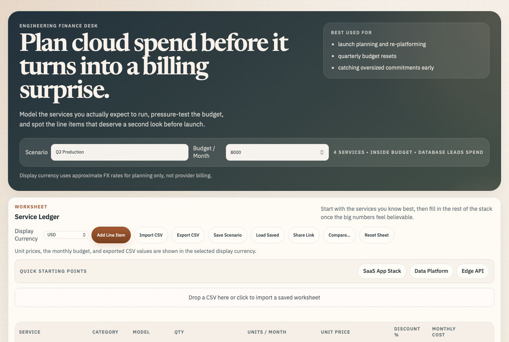

# Cloud Spend Planning Desk

This is a browser-based cost estimator for engineering leads and founders planning a launch budget, and it answers a what-if about a new service in seconds instead of in a spreadsheet.

Run it from a checkout. There is nothing to install and nothing to build:

```bash
open index.html
```



Live: [https://infrastructure-cost-visualizer.vercel.app/](https://infrastructure-cost-visualizer.vercel.app/)

## How it compares to the AWS Pricing Calculator

The [AWS Pricing Calculator](https://calculator.aws/) is the authoritative one, and this tool is not a replacement for it. That calculator covers every SKU the providers sell, applies the real region, term and tier rules, and its output is the number you can defend to finance. This one is a fast what-if board: three starter stacks, editable line items across seven spend categories, three pricing models with fixed multipliers, and a 12-month runway, all on one page that opens from disk with no account. Use it to find out whether a plan is roughly affordable and where the money concentrates, then price the real build in the AWS calculator. Do not quote its numbers as provider prices.

## What it does

- Add resources with quantities and pricing
- Compare On-Demand vs Reserved vs Spot side by side
- Set a budget and see instant over/under feedback
- View spend breakdowns by category and pricing model
- Project costs 12 months out with adjustable growth rate
- Toggle between USD, EUR, GBP
- Save scenarios to your browser (or to a backend if you want)

## How the math works

```
monthly = qty × units_per_month × unit_price × (1 − discount%) × pricing_multiplier
```

| Model     | Multiplier |
|-----------|-----------|
| On-Demand | 1.00      |
| Reserved  | 0.72      |
| Spot      | 0.35      |

Multipliers and FX rates live in `calc.js` and nowhere else. The app reads them from there so the unit tests cover the values the browser actually uses. The rates are approximate planning figures, not provider billing rates.

## What it does not do yet

- It does not model GPU hours or token costs. The ledger has no field for either, so inference or training spend has to go in as a priced line item you work out yourself.
- The service catalogue is three example stacks (SaaS App Stack, Data Platform, Edge API), not a list of provider SKUs. You supply the unit price.
- Reserved pricing is a single 0.72 multiplier. There is no term length, no upfront or partial-upfront option, and no savings plan.
- FX rates are hardcoded in `calc.js` (EUR 0.92, GBP 0.78) and only USD, EUR and GBP exist.
- Save, Load and Compare need the optional Node backend. On a `file://` page those buttons have nothing to talk to.

## The scripts

`index.html` loads five plain scripts and a stylesheet straight off disk:

| File | Job |
|---|---|
| `index.html` | markup and the row template |
| `styles.css` | layout and theme |
| `calc.js` | cost math, FX rates, number parsing |
| `csv.js` | CSV parse and escape |
| `normalize.js` | ledger row rules |
| `shareState.js` | share-link encoding |
| `app.js` | DOM wiring |

## Optional backend for saving scenarios

```bash
pnpm install
pnpm dev
```

Then open `http://localhost:3000`.

> **Restart the server after adding a file to the public allowlist.**
> `PUBLIC_FILES` in `server/app.js` is read once at startup, so a running
> `pnpm dev` will 404 a newly added script while `pnpm smoke` passes, because
> smoke builds a fresh app. Symptom: a blank page and a `ReferenceError` in the
> console for a name you can see in the file.

Prefer this over `npx serve .` for anything beyond a quick look. A generic static server on the repo root will happily hand out `data/scenarios.json` and `package.json`. The Express server serves an explicit allowlist and 404s everything else on purpose.

## Why vanilla JS?

This project intentionally has no framework. For a single-page tool that amounts to a fancy calculator, adding React, Vue or Svelte adds more complexity than it removes. There is no bundler, so what you read is what runs.

The cost logic is deliberately split out of `app.js` into `calc.js`, `csv.js`, `normalize.js` and `shareState.js`. Those files are pure and loaded as classic scripts, so the same source runs in the browser and under vitest without a build step. Anything that touches the DOM stays in `app.js`.

## Development

```bash
pnpm lint     # eslint
pnpm test     # vitest
pnpm smoke    # boots the server and exercises the API end to end
```

All three run in CI, and lint and test also run in the pre-commit hook. `pnpm smoke` additionally asserts that every `<script>` and `<link>` in `index.html` is actually served. A missing one 404s into a JSON error body, which the browser refuses to execute, and the app dies at boot with no useful diagnostics.

## Stack

Frontend: HTML, CSS, JavaScript (zero deps).
Backend (optional): Node.js, Express, JSON file storage.
